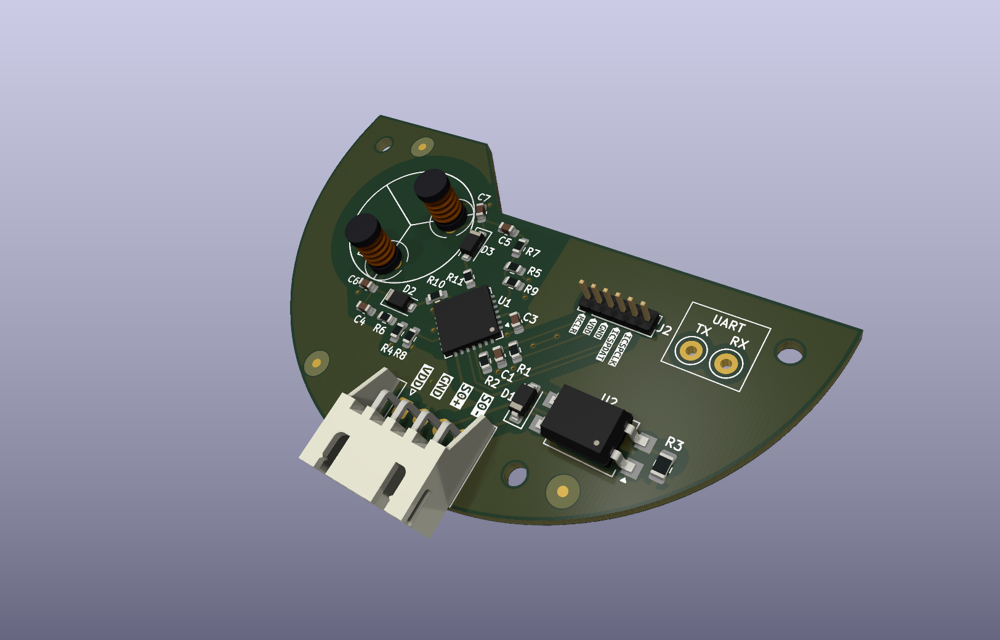

# Inductive water meter counter with S0 interface for GSB-8 meters

This is a custom water meter counter project to get an interface to analog water meter readings
for subsequent usage in Homeassistant. The project is outputting its readings via a generic S0
interface, though, to enable other use cases as well.

It features a custom 3D-printable model to snap on to the GSB-8 meter that houses the PCB. The
software doing the actual work is located in the [`firmware`](./firmware) folder. Since it is
based on a Microchip PIC controller, it requires the respective infrastructure to build.

Bundled assets are available as GitHub releases, including compiled firmware, 3MF file of the
housing and Gerber files for PCB production.

This project has been prototyped at [AISLER](https://aisler.net/p/BFTGUQNT). You can instantly
order as well by clicking on the badge at the top.
