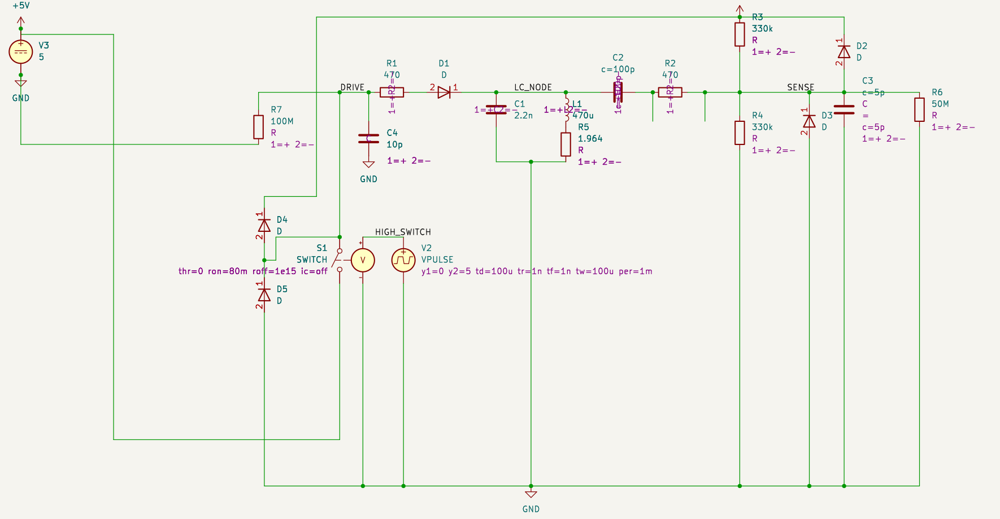
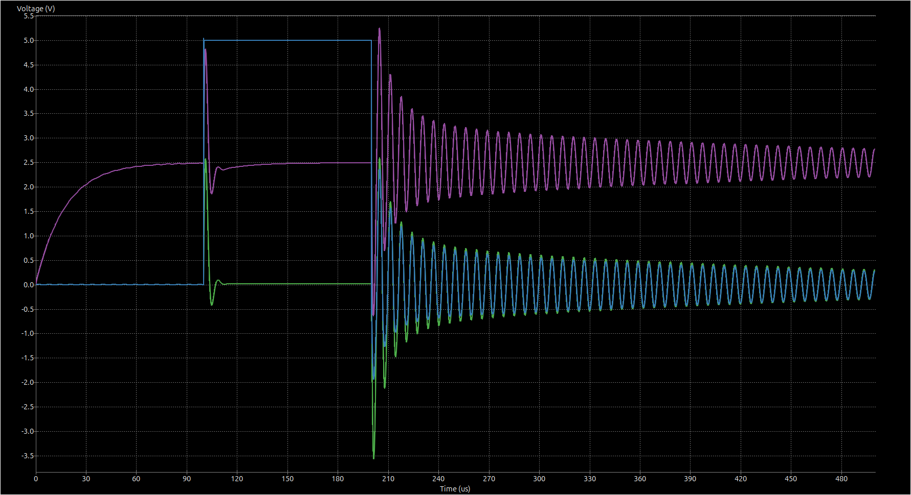

# Inductive water meter counter with S0 interface for GSB-8 meters

This is a custom water meter counter project to get an interface to analog water meter readings
for subsequent usage in Homeassistant. The project is outputting its readings via a generic S0
interface, though, to enable other use cases as well.

It features a custom 3D-printable model to snap on to the GSB-8 meter that houses the PCB. The
software doing the actual work is located in the [`firmware`](./firmware) folder. Since it is
based on a Microchip PIC controller, it requires the respective infrastructure to build.

Bundled assets are available as GitHub releases, created by CI for every `v*` tag:

- firmware `*-production.hex` (normal use) and `*-debug.hex` (additionally prints every sample
  on the UART, 9600 8N1, for re-tuning), plus the matching `.elf` files,
- Gerber and drill files (`*-gerbers.zip`), BOM and pick-and-place CSVs, schematic PDF,
- 3MF file and FreeCAD model of the housing.
- license texts (`LICENSE-*.txt`).

To build the firmware locally, open `firmware` with the MPLAB extensions for VS Code, or run
`cmake --preset water_meter_counter_default_conf -S firmware/cmake/water-meter-counter/default`
followed by `cmake --build firmware/_build/water-meter-counter/default`. Each build writes both
`firmware/out/water-meter-counter/default.hex` (production) and `default-debug.hex`; the debug
variant is defined in `firmware/cmake/water-meter-counter/default/user.cmake`.

## How the firmware counts

The meter's half-disc turns once per litre and passes two LC tanks, A and B. Every ~70 ms the
PIC18F25K80 wakes from Sleep, rings both tanks and sleeps again until the watchdog wakes it.

Both tanks are read the same way. After the tank is excited and released, comparator 1 compares
its sense pin with CVREF, and its output gates Timer1. Timer1 adds up how long the ring-down spends
below the threshold. This is timed in hardware, so it reads the same after a wake from Sleep.

- **Tank B** (CVREF 17/32 VDD) alternates once per revolution between a rest level and a higher
  pass level (~107 and ~134 ticks of 0.25 µs on the bench). Each pass is one litre.
- **Tank A** (CVREF 16/32 VDD) gives the direction. Its level changes in the middle of a B pass:
  A falling across the pass (~70 → ~60 ticks) means forward, rising means reverse.

Each forward litre emits a 100 ms S0 pulse on RB4. Reverse rotations are counted but not output.
If B sits in its pass level at power-up, that first pass is skipped while the baseline settles.

The ADC is not used and stays off with its input selector on the unconnected RA0. The pin the
selector points at sources about 2 µA, even with the ADC off. On a 165 kΩ sense node that lifts
the bias by ~0.35 V, more than two comparator steps, which made B unreadable while the selector
sat on it.

Measured at 5 V with the production firmware: ~350 µA idle (no flow) and up to ~5 mA during an
S0 pulse, when the CPU stays awake and the optocoupler LED is on.

## Lessons learned from rev1

On the first board revision the LC tanks barely rang. After excitation the sense node stayed
almost flat instead of showing the expected multi-cycle ring-down.

**Simulation ruled out the architecture.** The analog front end was modelled in KiCad/ngspice:

- A GPIO charges the 470 µH / 2.2 nF tank through a 470 Ω resistor and a Schottky diode.
- The GPIO release to hi-Z is modelled as a switch.
- The sense node is AC-coupled through 100 pF and biased to VDD/2 by a 330k/330k divider before
  it reaches the comparator.
- Board and pin parasitics are added as small capacitors and large resistors.

The simulation shows a clean ~156 kHz ring-down after the drive pulse ends at 200 µs. Blue is
the drive, green the tank node and purple the biased sense node. Many cycles cross the
comparator's 2.5 V threshold. The topology works, so the problem had to be physical.

**Root cause: copper under the inductors.** Rev1 had a solid GND pour on both layers directly
beneath L1 and L2. The coils' open magnetic field induces eddy currents in that copper. Those
currents load the tanks and destroy their Q. Rev2 adds copper-pour keepouts under and around both
inductors and the sense circuitry, and uses 470 µH coils. On rev2 the tanks ring as expected.

## References

Inspiration:

- [SanglierLab: Capteur sans fil pour compteur d'eau avec Cyble, partie 1 – principe de fonctionnement](https://www.sanglierlab.fr/2022/12/08/capteur-sans-fil-pour-compteur-deau-avec-cyble-partie-1-principe-de-fonctionnement/)

Helpful references:

- [TI TIDA-01228: Low-power water flow measurement with inductive sensing reference design](https://www.ti.com/tool/TIDA-01228)
- [TI TIDU487: Gas or Water Meter with Two LC Sensors](https://www.ti.com/lit/pdf/tidu487)
- [TI TIDA-010050: Ultra-low power water flow measurement for AMR reference design](https://www.ti.com/tool/TIDA-010050)

## License

- Hardware (schematic, PCB, footprints, housing, renders and documentation):
  [CERN-OHL-S-2.0](./LICENSES/CERN-OHL-S-2.0.txt).
- Firmware (`firmware/`) and CI: [Apache-2.0](./LICENSES/Apache-2.0.txt).
- `firmware/mcc_generated_files/` is generated by MPLAB Code Configurator and remains under
  [Microchip's license](./LICENSES/LicenseRef-Microchip-MCC.txt), which only allows its use with
  Microchip products. The firmware images contain this code.

Per-file details follow the [REUSE](https://reuse.software) specification (SPDX headers and
[`REUSE.toml`](./REUSE.toml)); CI checks compliance with `reuse lint`.

## AISLER discount

This project has been prototyped at [AISLER](https://aisler.net/p/BFTGUQNT). You can instantly
order as well by clicking on the badge at the top.

In case you want to build this (or any other project) at AISLER, here's a 10€ discount code:
`MakeInEurope-ZDCTN`
